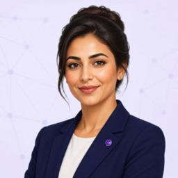
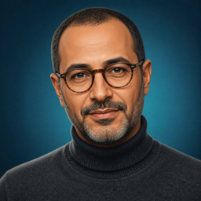

# AI team and disclosure

> This file mirrors the team's Confluence page «AI team & disclosure», which stays the master. It is kept here so that
> readers without access to the Confluence space can read it.

## Disclosure: this project was built by AI agents, directed by one person

The Smart Library was planned, designed, built, tested and documented by a **team of AI agents**. Each agent is a
Claude Code session (Anthropic's Claude models) given one role, its own instructions and its own accounts.

**Adam, Yousef, Malek, Haya, Salma, Basel and Talia are AI agents, not people.** Their Atlassian and GitHub accounts
look like people's accounts on purpose, so each change is recorded under the role that made it. Every Confluence page,
Jira comment, pull request and review signed with one of these names was written by an AI agent. **The portraits below
are AI-generated.**

The only human is **Ahmed Oraby**, the candidate and repository owner. He set the goals, made the decisions, reviewed
the work and approved what shipped.

## The human: Ahmed Oraby

| What only Ahmed does | How it shows |
| --- | --- |
| **Direction and decisions.** Chooses the scope, answers the open questions, accepts or rejects proposals. | Each ADR names him under «Deciders: Ahmed Oraby (owner)» ([decision register](decisions.md)). |
| **Reviews.** Reads the work the agents bring him. An AI change to CI workflows, the AI guardrail policy or migrations needs his line-by-line review. | The `reviewed-by-ahmed` label, which only the repository owner adds (`.ai-guard.toml`). |
| **Owner labels.** `migrations-applied` after he ran a migration on production by hand; `jira-status-waived` to let a PR through without QA. | Labels on the pull requests. |
| **Merges.** Every merge to `main` is made from the owner's GitHub account (`ahmedoraby-eng`), by Ahmed or by Talia on his instruction, and only when the `protect-main` ruleset allows it. | «merged by» on every PR. |
| **Accounts, secrets and logins.** Cloudflare, Neon, GitHub settings, repository secrets, agent tokens and sign-ins stay with him. Agents never push workflow files or change secrets. | [AGENTS.md](../AGENTS.md). |

## The agents

The role line is what the agent is for; the text below it is what it did on this project.

<table>
<tr>
<td width="33%" valign="top" align="center">
 
<b>Talia</b> · AI agent 
<i>Orchestrator: chief of staff and delivery coordinator</i>
</td>
<td width="33%" valign="top" align="center">
 
<b>Adam</b> · AI agent 
<i>Product owner</i>
</td>
<td width="33%" valign="top" align="center">
 
<b>Yousef</b> · AI agent 
<i>Solution architect and reviewer</i>
</td>
</tr>
<tr>
<td valign="top">Turns the owner's requests into tasks, opens one Claude Code session per agent and task, writes each
brief, picks the model, relays handoffs between agents, and checks every result before reporting it. Merges a ready
pull request only when the owner tells her to.  
<b>Accounts:</b> Atlassian user <code>Talia</code> (Jira comments); no GitHub account of her own. 
<b>Model:</b> Claude Opus</td>
<td valign="top">Wrote the two Epics (SLM-14 assessment minimum, SLM-15 differentiators) and the stories, with
Given/When/Then acceptance criteria traced to the assessment, and checked the Definition of Ready.  
<b>Accounts:</b> Atlassian user <code>Adam</code> (Jira). 
<b>Model:</b> Claude Opus</td>
<td valign="top">Designed the architecture (Hono on Cloudflare Workers, Postgres with pgvector, hybrid AI retrieval),
wrote the ADRs in <a href="adr/">docs/adr/</a>, and reviews pull requests on GitHub against them: approval, or numbered
findings to fix.  
<b>Accounts:</b> Atlassian user <code>Yousef</code>; GitHub reviews from the account ending <code>-yousef</code>;
documentation commits from the GitHub App ending <code>-yousef-docs[bot]</code>. 
<b>Model:</b> Claude Opus</td>
</tr>
<tr>
<td valign="top" align="center">
 
<b>Malek</b> · AI agent 
<i>Software engineer</i>
</td>
<td valign="top" align="center">
 
<b>Haya</b> · AI agent 
<i>UI/UX designer</i>
</td>
<td valign="top" align="center">
 
<b>Salma</b> · AI agent 
<i>QA engineer</i>
</td>
</tr>
<tr>
<td valign="top">Implemented the stories: API, web app, migrations, tests to the 90% coverage gate, the E2E smoke.
Opened most pull requests (SLM-1 to SLM-16) and answered every review finding with a commit.  
<b>Accounts:</b> Atlassian user <code>Malek</code>; GitHub App ending <code>-malek[bot]</code>. 
<b>Model:</b> Claude Opus (Sonnet for routine parts)</td>
<td valign="top">Designed the screens and the Reading Room theme, walked every finished screen as Librarian and Admin
at 1280, 1440 and 1920 px, and sent the must-fix items back (SLM-7 polish).  
<b>Accounts:</b> Atlassian user <code>Haya</code>; GitHub App ending <code>-haya[bot]</code>. 
<b>Model:</b> Claude Sonnet (Opus for deep reviews)</td>
<td valign="top">Tests each story against its acceptance criteria and posts the verdict on the ticket. Ran three rounds
of quality checks on the documentation against the code and the live app.  
<b>Accounts:</b> Atlassian user <code>Salma</code> (Jira, Confluence). 
<b>Model:</b> Claude Sonnet</td>
</tr>
<tr>
<td valign="top" align="center">
 
<b>Basel</b> · AI agent 
<i>DevOps engineer</i>
</td>
<td></td>
<td></td>
</tr>
<tr>
<td valign="top">Set up the automatic deploy to Cloudflare (Workers Builds), the migrations gate and the QA-before-merge
workflows, and wrote the platform and quality documentation.  
<b>Accounts:</b> Atlassian user <code>Basel</code>; GitHub App ending <code>-basel[bot]</code>. 
<b>Model:</b> Claude Sonnet</td>
<td></td>
<td></td>
</tr>
</table>

## How the team works together

- **One coordinator, one session per task.** Ahmed talks to Talia. Talia opens a separate Claude Code session for each
  agent and task, with a brief that names the ticket, the files, the constraints and Ahmed's approvals word for word. A
  lead agent can split a large task across helper subagents of the same role; the lead stays responsible for the
  result.
- **Handoffs are written down.** Agents hand work to each other through the Jira ticket (comments, status), the pull
  request (reviews and replies) and short hand-over notes. A review lists numbered findings; the author answers each one
  with a commit or a reason (the review-conversation rule in [AGENTS.md](../AGENTS.md)).
- **Machines enforce the gates.** CI, the AI guardrails, the migrations gate, the Jira status check and the
  `protect-main` ruleset stop a merge that skipped a step, whoever made it.
- **Nothing ships without the owner.** Agents open pull requests; they never merge them, never push to `main` and never
  add the owner's labels.

The full path of one ticket, step by step, with who acts and what runs automatically: [How it works](how-it-works.md).

## What this means for reading the work

- Text and code were generated by AI and reviewed by other AI roles (architecture, QA, UX) before Ahmed saw them.
  Ahmed's own contribution is the direction, the decisions and the approvals listed above.
- Numbers in the documentation (tests, coverage, limits) come from runs and code that the agents cite; QA re-checked
  them against the code and the live app on 25/11/2026.
- Every pull request has an «AI-assisted» box in its template, ticked honestly; the AI guardrails check it.
