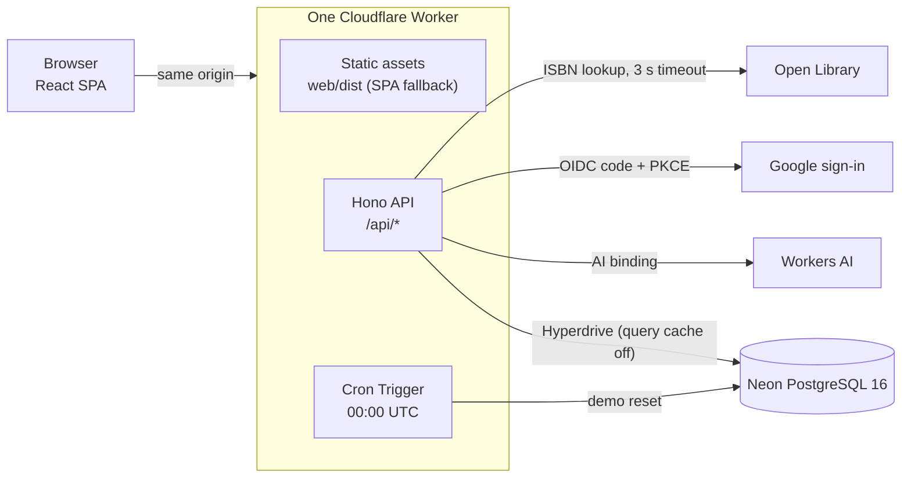

# Architecture

Smart Library is one Cloudflare Worker. It serves the React app and the `/api` routes from the same URL, and talks to PostgreSQL 16.

## System overview



- Requests to `/api/*` reach the Worker code first (`run_worker_first` in `wrangler.toml`). Everything else is a static asset, with a fallback to the SPA.
- Each API request opens one database connection and closes it afterwards. In production the connection string comes from the Hyperdrive binding. Locally it comes from `DATABASE_URL`.
- The Worker has no state of its own. Sessions are signed cookies, and all data is in Postgres.

## Layers and modules

The API is a modular monolith. Each module is a folder under `api/src/`:

| Module | What it owns |
|---|---|
| `catalog` | Books, stock statements, ISBN lookup (Open Library) |
| `members` | Members (no login, no delete) |
| `circulation` | Borrow, return, loan history, derived loan status |
| `staff` | Staff users, sign-in (Google, demo), role and status changes |
| `discovery` | AI book discovery (see [ai.md](ai.md)) |
| `dashboard` | One read-only summary query |
| `demo` | Demo data reset (nightly job and Admin button) |
| `platform` | Config, errors (Problem Details), clock, security (session, CSRF, rate limits, permissions) |

Inside a module the dependency direction is fixed:

```
api  →  application  →  domain  ←  infrastructure
```

- `api`: Hono routes. Parse the request with the zod schemas from `contracts/`, check the permission, call a service, map the result to JSON.
- `application`: services that run one use case. They own transactions.
- `domain`: rules and ports (interfaces). No framework, no driver.
- `infrastructure`: Postgres repositories, the Workers AI provider, the Google OIDC client, the Open Library client.

`npm run lint:deps` (dependency-cruiser, config in `.dependency-cruiser.cjs`) fails on:

- domain code importing Hono, Drizzle, `pg`, `jose` or Cloudflare packages;
- domain code importing from `api`, `application` or `infrastructure`;
- application code importing from `api`, `infrastructure`, Hono, Drizzle or `pg`;
- a module reading another module's Drizzle schema (`schema.ts`);
- the web app importing anything from `api/`;
- circular imports.

`contracts/` holds the zod schemas, the role and permission lists, and error codes. The API validates with them and the UI imports the same types, so the two sides can't drift.

The web app (`web/src`) is organised by feature (`books`, `circulation`, `members`, `dashboard`, `discovery`, `staff`, `auth`). Filters, sort and page live in the URL (TanStack Router). Server data goes through TanStack Query. The UI reads the user's permissions from `GET /api/me` to show or hide actions; the API enforces them anyway.

## Domain model and invariants


Tables (`migrations/0001_init.sql`): `staff_users`, `books`, `members`, `loans`. `0002_search.sql` adds a generated full-text column and trigram indexes to `books`, and a trigram index on member names. `0003_google_sub.sql` adds the Google account id to `staff_users`.

- **Copies are counts, not records.** A book has `total_copies` and `available_copies`. There is no per-copy entity.
- **Stock invariant.** `0 <= available_copies <= total_copies` is a `CHECK` constraint. Available plus on-loan always equals total, where on-loan is the number of open loans of that book.
- **Loan status is derived, never stored.** `RETURNED` if `returned_at` is set; `OVERDUE` if open and `due_at` is before now; otherwise `ACTIVE`. One SQL fragment (`loanSql.ts`) is used by the list filter, each row and the dashboard count, so they can't disagree.
- **One open loan per member and title.** A partial unique index on `(member_id, book_id) WHERE returned_at IS NULL`.
- **Books are archived, not removed, once they have history.** `loans.book_id` is `ON DELETE RESTRICT`. A book with open loans can't be deleted; with only past loans it is archived (`archived_at`); never borrowed, it is deleted. An archived book's ISBN can be reused (the ISBN unique index covers active books only).
- **Optimistic concurrency.** Books and members carry a `version`. An update with an old version gets `409 STALE_VERSION`.
- **Loan rules.** Member must be `ACTIVE`; no second open loan of the same title; open loans below `MAX_ACTIVE_LOANS` (default 5); due date defaults to `LOAN_DAYS` (14), or a custom date 1 to 60 days ahead. Returns are accepted for inactive members and archived books.

### Borrow and return

Both are one Postgres transaction (READ COMMITTED). Any error rolls everything back.

Borrow (`CirculationService.borrow`):

1. `SELECT ... FOR UPDATE` on the member row. This serialises one member's borrows, which makes the loan-limit check safe.
2. Check the member is active, doesn't hold this title, and is under the limit.
3. `UPDATE books SET available_copies = available_copies - 1 WHERE id = ? AND archived_at IS NULL AND available_copies > 0`. The update takes the book's row lock, so parallel borrows of the last copy are decided by the database: one wins, the rest see zero rows and get `409 BOOK_UNAVAILABLE`.
4. Insert the loan.

Return (`CirculationService.return`):

1. `UPDATE loans SET returned_at = ?, returned_by = ? WHERE id = ? AND returned_at IS NULL`. Two parallel returns: one updates a row, the other updates none and gets `409 LOAN_ALREADY_RETURNED`.
2. `UPDATE books SET available_copies = available_copies + 1`.

Deleting a book locks the book row first, so a borrow running at the same time waits and then finds the book archived or gone; if the borrow takes the row first, the delete then sees the open loan and gets `409 BOOK_HAS_ACTIVE_LOANS`.

The tests run these paths in parallel against real Postgres (for example, 20 borrows of a 3-copy book give 3 successes). The `CHECK` constraint and the unique index are the last line of defence behind the guarded updates.

## API overview

All paths start with `/api`. Errors use RFC 9457 Problem Details (`application/problem+json`) with a stable `code` and a `requestId`. List endpoints take `page`, `size` and `sort` and return `{ items, total, page, size }`.

| Method and path | Who | Purpose |
|---|---|---|
| `GET /health` | public | Liveness (`?deep=1` also checks the database, rate-limited) |
| `GET /auth/providers` | public | Which sign-in methods are on |
| `GET /auth/google/start`, `GET /auth/google/callback` | public | Google sign-in |
| `POST /auth/demo-login` | public | Demo account sign-in |
| `POST /auth/logout` | public | Clear the session cookie |
| `GET /me` | any role | Current user and permissions |
| `GET /books`, `/books/categories`, `/books/:id` | A, L, S | Search, filters, detail |
| `GET /books/isbn-lookup` | A, L | Open Library suggestion for an ISBN |
| `POST /books`, `PUT /books/:id` | A, L | Create, edit |
| `DELETE /books/:id` | A | Delete or archive |
| `GET /members`, `/members/:id`, `/members/:id/loans` | A, L, S | Read |
| `POST /members`, `PUT /members/:id` | A, L | Create, edit, deactivate |
| `GET /loans`, `/loans/:id` | A, L, S | Loan history |
| `POST /loans/borrow`, `POST /loans/:id/return` | A, L | Borrow Book, Return Book |
| `GET /dashboard/summary` | A, L, S | Dashboard numbers |
| `POST /ai/book-discovery` | A, L, S | AI discovery |
| `GET /staff-users`, `PUT /staff-users/:id` | A | Staff management |
| `POST /admin/reset-demo` | A | Restore demo data |

A = Admin, L = Librarian, S = Supervisor. This table is checked by the `rbac-matrix` test, which fails if a route has no row or a row has no route.

## Roles

| Permission | Admin | Librarian | Supervisor |
|---|---|---|---|
| `BOOK_READ`, `MEMBER_READ`, `LOAN_READ`, `REPORT_READ`, `AI_DISCOVER` | yes | yes | yes |
| `BOOK_WRITE`, `MEMBER_WRITE`, `LOAN_PROCESS` | yes | yes | no |
| `BOOK_DELETE`, `STAFF_MANAGE` | yes | no | no |

The permission lists are in `contracts/src/auth.ts`. Every protected route declares the permission it needs with `requirePermission(...)`.

## Authentication and authorization

- **Sign-in.** Google OpenID Connect (authorization code with PKCE, state and nonce; the ID token is verified and `email_verified` must be true), or one of two demo accounts. A wrong demo email and a wrong password give the same `401`. Demo sign-in is limited to 5 attempts a minute per IP.
- **New Google users.** An email in `BOOTSTRAP_ADMIN_EMAILS` becomes Admin on first sign-in. Any other becomes a read-only Supervisor. An Admin can promote them. A disabled user gets `403 USER_DISABLED`.
- **Google account binding.** A staff user is found by Google's account id (`sub`) first, then by email; the `sub` is stored on the first match, and another Google account with the same email is refused. Google sign-in never opens a demo account, and demo emails must be on a reserved domain (`.test`, `.invalid`, `.example`).
- **Staff changes under lock.** A role or status change locks the target and every active Admin row, then re-checks that the actor is still an active Admin, that it is not their own row, that the row is not a demo account, and that at least one active Admin remains.
- **Session.** A signed JWT (HS256) in an `HttpOnly`, `SameSite=Lax` cookie (`Secure` in production and on https), `Path=/`, 8 hours by default. It holds only the staff id.
- **Role from the database.** On every request the API loads the staff row and builds the permissions from the stored role. A role change or a disable applies on the next request. A cookie that claims a role has no effect (tested).
- **CSRF.** Every non-GET request must have an `Origin` equal to the request's origin, and a body, if any, must be JSON.
- **Rate limits.** Demo login (5 per minute per IP), Google start and Google callback (10 each per IP), AI discovery (10 per user), deep health check (10). In production these use Workers Rate Limiting bindings, shared across locations. Without a binding, a per-isolate in-memory limiter is used.
- **Demo credentials** come from Worker secrets, are compared as SHA-256 digests in constant time, and passwords must be 12+ characters. They are never stored in the database or the repository.
- **No auth bypass.** There is no flag, header or environment that signs a user in without credentials.

## Key decisions

Every decision taken so far (183 on 2026-11-25), with the options we weighed and what we gave up, is an ADR in [`adr/`](adr/), listed in the [decision register](decisions.md). The main ones:

- Stack: TypeScript, Hono on Workers, PostgreSQL 16 ([ADR-0002](adr/0002-stack-typescript-hono-workers-postgres.md)).
- Modular monolith with layers enforced in CI ([ADR-0004](adr/0004-modular-monolith-enforced-layers.md)).
- Copies as counts, with guarded updates in one transaction ([ADR-0006](adr/0006-copies-as-counts-guarded-updates.md)).
- Sign-in: Google OIDC plus demo accounts ([ADR-0009](adr/0009-google-oidc-and-demo-accounts.md)); roles read on every request ([ADR-0011](adr/0011-roles-read-per-request.md)).
- AI: the model only ranks, behind a validator and a fallback ([ADR-0013](adr/0013-llm-ranks-only-validator-fallback.md)); hybrid retrieval ([ADR-0016](adr/0016-hybrid-retrieval-rrf.md)); cost tiers ([ADR-0019](adr/0019-ai-cost-tiers-and-quotas.md)).
- Deploy: Workers Builds, with migrations behind a gate ([ADR-0022](adr/0022-workers-builds-auto-deploy.md)).
- Rate limiting: Workers bindings with an in-memory fallback ([ADR-0103](adr/0103-rate-limiting.md)).

## Deployment

Every merge to `main` deploys to production through Cloudflare Workers Builds (Git integration): it runs `npm ci`, the build command `npm run build`, and the deploy command `npx wrangler deploy --env production`. Its check on the merge commit is `Workers Builds: smart-library`. `npm run deploy` does the same by hand. `wrangler.toml` sets the static assets, the cron triggers (`0 0 * * *` reset, `5 * * * *` index backfill), the rate-limit bindings and public vars; `[env.production]` adds the Hyperdrive and Workers AI bindings. Secrets (`SESSION_SECRET`, `GOOGLE_CLIENT_SECRET`, the demo passwords) are set once with `wrangler secret put <NAME> --env production` and persist across deploys; no secret is in the repository or in the build settings.

Database migrations are not part of the deploy: they are run by hand on production (`DATABASE_URL=<connection string> npm run db:migrate`) before the PR that adds them is merged. The `migrations gate` check fails on a PR that adds or changes a file under `migrations/` until the PR has the label `migrations-applied`.

CI (`.github/workflows/ci.yml`) runs a secret scan and a name check, then typecheck, `lint:deps`, tests on a PostgreSQL 16 service container, and the web build.
