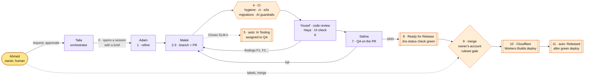

# How it works: one ticket from refinement to deployed

> This file mirrors the team's Confluence page «5 · Ticket journey: from refinement to deployed», which stays the
> master. It is kept here so that readers without access to the Confluence space can read it.

How one Smart Library ticket travels from a refined story to working software on the live URL, who acts at each step,
and what the board shows. Since 25/11/2026 QA tests the pull request **before** the merge, and the merge waits for QA
([ADR-0185](adr/0185-qa-tests-pr-before-merge.md)). Deploy and release stay automatic.

Every role on this page is an **AI agent** (a Claude Code session) except the repository owner, Ahmed Oraby. The agents
and their accounts are described in [AI team and disclosure](ai-team.md).

> **On since 25/11/2026 (about 10:00 Cairo):** the `protect-main` ruleset on `main` (required checks `hygiene`,
> `ci / Build and test`, `e2e`, `migrations` and `Jira status`; squash merge only; branch up to date with `main`; no
> bypass list), and the two QA-before-merge workflows (PRs #34 and #36). Earlier stories ran under the older order shown
> in the example at the end.

## The flow at a glance

Yellow: the human. Purple: AI agents. Orange: automation and gates.

## The board

Jira space **Smart Library** (key `SLM`), a team-managed Kanban board. Five statuses: **Refinement → In Development →
In Testing → Ready for Release → Released** ([ADR-0051](adr/0051-board-flow-refinement-development-testing-released-review.md),
and [ADR-0185](adr/0185-qa-tests-pr-before-merge.md) for Ready for Release). 17 issues: 14 stories (SLM-1 to SLM-13,
and SLM-16, hybrid retrieval) under two Epics, SLM-14 (assessment minimum) and SLM-15 (differentiators), and one
sub-task, SLM-17 (the demo voice-over, under SLM-11).

**Linked to GitHub.** The GitHub for Jira app connects the project to this repository, so each issue shows its
branches, pull requests and commits, found by the `SLM-n` key in their names.

## Step by step

| # | Step | Who | What happens | Board |
| --- | --- | --- | --- | --- |
| 0 | Start | Orchestrator _(Talia)_ | Opens a separate Claude Code session for the agent who owns the next step, with a brief: the ticket key, the acceptance criteria, the files, the constraints and the owner's approvals word for word, and the model for the job. On this project every agent session is started this way; no automatic pickup runs on SLM. | – |
| 1 | Refine | Product owner _(Adam)_ | Writes the story, its rules and acceptance criteria in Given/When/Then, each traced to the original assessment. Checks the Definition of Ready: testable ACs, dependencies known, API contract agreed with the architect and the engineer, screens specified by the UX designer. | Refinement |
| 2 | Pick up | Engineer _(Malek)_ | Moves the ticket to In Development and posts a short "picked up" comment. Works on a branch named after the key, `<name>/SLM-n-…`. | In Development |
| 3 | Pull request | Engineer _(Malek)_ | Opens a PR to `main` titled with the key. The PR template asks for `Refs SLM-n` for a partial PR, or `Closes SLM-n` for the PR that completes the ACs ([ADR-0066](adr/0066-branch-commit-pr-names-carry-slm-key.md)), and the ACs are mapped to tests. | In Development |
| 4 | CI | GitHub Actions | `hygiene` (gitleaks secret scan, forbidden names), `ci / Build and test` (the shared Node CI: typecheck, dependency rules, lint, format check, build, tests on PostgreSQL 16 with the 90% coverage gate, audit of production dependencies), `e2e` (Playwright smoke), the `migrations` gate, and the AI guardrails (AI-assistance box, tests with source changes, owner review on protected paths). The ruleset requires all of them except the AI guardrails, which report but do not block. | – |
| 5 | To In Testing | Automatic | When a PR opens (or leaves draft) with `Closes SLM-n`, the `jira-ready-for-testing` workflow moves SLM-n from In Development to In Testing, assigns it to QA and comments the PR link. `Refs`, the title and the branch move nothing, an issue in any other status is left alone, and a PR from a fork never moves an issue. | In Testing |
| 6 | Code review and UI check | Architect _(Yousef)_; UX reviewer for UI _(Haya)_ | The architect reviews on GitHub against the architecture decisions and approves, or asks for changes, which come back as new commits on the same PR. For UI changes the UX reviewer walks the screens as the demo Librarian and Admin at 1280, 1440 and 1920 px. The conversation follows the review rule below ([ADR-0052](adr/0052-review-flow-per-pr-architecture-github-ux.md)). | In Testing |
| 7 | QA on the PR | QA _(Salma)_ | Tests the PR against every AC: its CI and E2E results, and a manual check on the PR's branch (`npm run demo:local`). Posts the result on the ticket. Pass: moves the issue to Ready for Release. Fail: moves it back to In Development with the defects; the fixes come as new commits on the same PR, then QA tests again. | In Testing |
| 8 | QA passed | QA _(Salma)_, then automatic | The issue is in **Ready for Release**. The `jira-status` workflow turns the PR's **Jira status** check green; it is red while any SLM issue the PR names (title, branch, a Closes/Refs line) is in another status. It refreshes on every push, title or label change, and every 15 minutes. | Ready for Release |
| 9 | Merge | Repository owner _(Ahmed, or Talia on his instruction, from his account)_ | Squash-merges the PR into `main`: one commit per PR. The `protect-main` ruleset blocks the merge until the required checks are green and the branch is up to date with `main`; nobody can bypass it. Only the owner's `jira-status-waived` label can let a PR through without QA. A `Refs` PR waits for QA too, because it names the issue. | Ready for Release |
| 10 | Deploy | Automatic | The merge triggers Cloudflare Workers Builds, which builds and deploys to production; the GitHub check `Workers Builds: smart-library` shows the result on the merge commit. A migration, if any, was run by hand before the merge ([ADR-0022](adr/0022-workers-builds-auto-deploy.md)). | – |
| 11 | Release | Automatic | When a PR whose description says `Closes SLM-n` is merged, `jira-close.yml` waits up to 12 minutes for a successful `Workers Builds: smart-library` on the merge commit or a later one, then moves SLM-n to Released, with a comment listing the PR links. No successful build: the issue stays where it is, with a comment ([ADR-0023](adr/0023-close-on-merge-after-deploy.md)). **Released means tested and deployed.** | Released |

## What is automatic and what is manual

| Automatic | Manual |
| --- | --- |
| CI on every push; the move to In Testing when a Closes PR opens; the Jira status check; deploy on every merge to `main`; the move to Released after a successful deploy (`Closes` only); branches, PRs and commits shown on the issue | Starting a ticket (the orchestrator opens the agent's session); QA's verdict (Ready for Release, or back to In Development); the merge; database migrations before the merge; a rollback |

## Review conversations

Rule since 25/11/2026, for every review on a PR:

1. The reviewer numbers the findings (F1, F2, …) and marks each one: must fix before approval, OK, or a follow-up for
   later.
2. The author replies on the PR with **one line per finding**: what was done and the commit SHA, or why not.
3. The author asks for a re-review; the reviewer marks each finding resolved or still open and approves when the
   must-fix ones are resolved.

**Comments on Jira reach the agents.** An hourly relay reads new comments on Jira issues: a comment reaches the issue's
assignee unless the assignee wrote it, and `@Name` also reaches that agent; `FYI @Name` and `CC @Name` are information
only. The answer comes on the issue as a signed comment, and signed replies never loop back. SLM joined the relay on
25/11/2026. The relay is an hourly script on the owner's machine; an n8n workflow runs the same rules read-only next to
it (a shadow run, compared with the script) until it can replace it. The orchestrator reads the relay's inbox and passes
each comment to the addressed agent's session.

## Orchestration and the owner's reviews

Ahmed (owner, the only human) → Talia (orchestrator) → one session per agent and task → work lands in Jira (status,
comments) and GitHub (pull request, review) → machines check the gates → Ahmed approves and merges.

| Who | Role in the flow | What they do and do not do |
| --- | --- | --- |
| **Ahmed Oraby** (human, owner) | Direction, decisions, approvals | Sets the goal and the scope, answers open questions, decides between options (each ADR names him as decider). Reviews line by line any AI change to CI workflows, the AI guardrail policy or migrations and then adds `reviewed-by-ahmed`. Runs migrations on production and adds `migrations-applied`. Only he can waive the Jira status check (`jira-status-waived`). Holds every account, secret and login. Every merge is made from his GitHub account. |
| **Talia** (AI, orchestrator) | Routing, handoffs, follow-up | Splits a request into tasks and opens one session per agent and task (step 0), with the model chosen by how hard the task is. Passes each handoff to the next agent: a review to the author, a QA failure back to the engineer, a Jira comment from the relay to its addressee. Checks each result herself (the PR, the diff, the page) before reporting it to Ahmed. Merges only a PR that is green, approved by the architect and in Ready for Release, and only when Ahmed has told her to. |
| **Yousef** (AI, architect) | Design before, review after | Writes the plan before major work, and reviews pull requests on GitHub against the ADRs: approval, or numbered findings (F1, F2, …) that the author answers commit by commit. He never writes the product code. |
| **Haya** and **Salma** (AI) | UX check and QA | Haya walks the changed screens; Salma tests the acceptance criteria on the PR and sets the Jira status that unlocks the merge. |

## The automation behind each step

| Step | Mechanism | Where it runs | What it does |
| --- | --- | --- | --- |
| 2–3 | GitHub for Jira app | Jira ↔ GitHub | Shows the branches, PRs and commits of each `SLM-n` issue on the issue. |
| 4 | [`ci.yml`](../.github/workflows/ci.yml), [`e2e.yml`](../.github/workflows/e2e.yml), [`ai-guard.yml`](../.github/workflows/ai-guard.yml), [`migrations-gate.yml`](../.github/workflows/migrations-gate.yml) | GitHub Actions, on every PR and push | The checks of step 4. `ci` and `ai-guard` call shared reusable workflows; the guardrail policy is [`.ai-guard.toml`](../.ai-guard.toml). |
| 5 | [`jira-ready-for-testing.yml`](../.github/workflows/jira-ready-for-testing.yml) + [`scripts/jira-ready-for-testing.mjs`](../scripts/jira-ready-for-testing.mjs) | GitHub Actions, when a PR opens, reopens or leaves draft | Moves each `Closes` issue still In Development to In Testing, assigns it to QA, comments the PR link. Runs the script from `main`, never the PR's code. |
| 8 | [`jira-status.yml`](../.github/workflows/jira-status.yml) + [`scripts/jira-status-check.mjs`](../scripts/jira-status-check.mjs) + [`.github/jira-status.json`](../.github/jira-status.json) | GitHub Actions, on PR events and every 15 minutes | Sets the `Jira status` commit status: green only when every SLM issue the PR names is in Ready for Release (or the owner's waiver label is on). |
| 9 | `protect-main` ruleset | GitHub | Blocks the merge until the five required checks pass on a branch up to date with `main`; squash only; no force push or deletion of `main`; no bypass list. |
| 10 | Cloudflare Workers Builds | Cloudflare, on every push to `main` | Builds and deploys the Worker; reports the `Workers Builds: smart-library` check on the commit. |
| 11 | [`jira-close.yml`](../.github/workflows/jira-close.yml) (shared reusable workflow) | GitHub Actions, when a PR is merged | Waits up to 12 minutes for a green deploy check, then moves each `Closes` issue to Released and comments the PR links. |
| any | Jira comment relay | Hourly script on the owner's machine; n8n shadow workflow | Finds new comments addressed to an agent and queues them for the orchestrator to deliver. |

The deploy, the Jira moves and the merge gate run without anyone pressing a button. Decisions stay manual: starting
work, QA's verdict, the merge, migrations and rollbacks.

## A real example: SLM-4, Borrow Book and Return Book (before ADR-0185)

The inventory-integrity story, traced end to end under the earlier order, where QA ran on `main` after the merge (times
are Cairo, 24/11/2026). Under today's order, QA would have tested PR #8 before the 18:48 merge.

| Time | Step | Evidence |
| --- | --- | --- |
| ~18:00 | Ticket created with 9 ACs (borrow, return, limits, 20 parallel borrows on 3 copies give exactly 3 loans) | SLM-4, parent SLM-14, priority Highest |
| 18:18 | The engineer picks it up | Status moved, comment "Picked up" |
| 18:39 | PR opened from the branch `…/SLM-4-circulation`, body says `Closes SLM-4` | PR #8: one Postgres transaction per borrow and return, conditional stock update, race tests |
| 18:41 | The architect approves: "matches architecture §3.4" | GitHub review on PR #8 |
| 18:46–18:47 | CI green after the rebase onto `main` (hygiene, test); the architect re-approves the rebased head | Checks and second review on PR #8 |
| 18:48 | Squash-merged to `main` | Commit `cb7d6a2` |
| 18:54 | QA tests the merged `main`: PASS, no defects (38 API checks: 401/403 by role, stock 2→1→0 and never negative, second return 409, unavailable book blocked in the Borrow screen) | Two QA comments on SLM-4 |
| evening | The UX pass covers the Borrow and Return screens; its must-fix items (one loan status everywhere, table widths) land in the SLM-7 polish PR and pass the re-check | UI pass 1 and 2; PR #11 |
| ~21:30 | Deployed to Cloudflare Workers by hand (before auto-deploy existed); health and database checks OK | Live URL in the README |

Board state: SLM-4 stayed In Development until it was moved to Released by hand on 25/11/2026 at 06:04 Cairo, in one
board clean-up with the other finished stories. The real order then was: merge, QA on `main`, deploy, Released. That
order is what ADR-0185 replaced.
